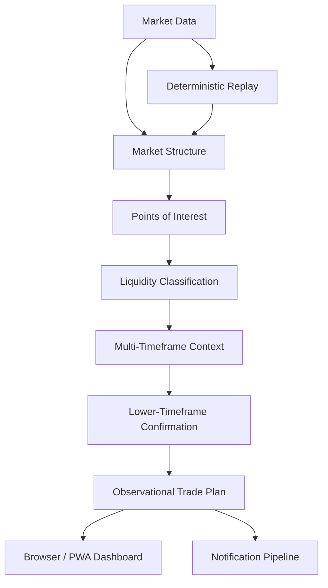

# Forex Trader Research System

**A deterministic multi-timeframe FX research and live-observation platform.**

This project models an SMC/ICT-inspired EUR/USD research workflow across multiple timeframes, then runs the same analysis pipeline in deterministic replay and live-observation modes.

The production source repository is private. This public repository documents the architecture and engineering scope without exposing the implementation.

## System overview



## What the system does

### Multi-timeframe strategy analysis
The engine builds market structure, derives and tracks points of interest, classifies liquidity, applies higher-timeframe blocking, and evaluates lower-timeframe confirmation before producing observational trade plans.

The live pipeline spans higher and lower timeframes rather than treating each chart independently.

### Deterministic replay
A major part of the project is replayability. The same strategy-analysis path can be run offline over historical candles with controlled temporal availability.

The replay layer is designed to make subtle issues testable, including:

- chronology violations
- future-data leakage
- look-ahead behavior
- state reconstruction
- deterministic decision ordering
- regression behavior across strategy changes

### Live observation
The system can observe OANDA practice-market data continuously, drop forming candles, enforce temporal boundaries, and expose current analytical state through a local browser dashboard.

It is an **observation/research system**, not an automated execution engine. It does not place or manage broker orders.

### Durable notifications
Analysis events pass through a notification policy and deduplication layer before entering a transactional SQLite outbox. Delivery is performed asynchronously using standards-based Web Push.

This provides a durable boundary between “an alert should exist” and “a device happened to be reachable at that instant.”

### Browser + iPhone workflow
The observer serves a browser dashboard with live quotes, charts, lower-timeframe overlays, and trade-plan state. The UI can also be installed as an iPhone Home Screen PWA and accessed privately through Tailscale.

## Architecture

```text
OANDA practice data
        ↓
Data / candle management
        ↓
Strategy analysis pipeline
        ↓
Live observer
   ├── Browser dashboard / PWA
   ├── Notification event pipeline
   └── Web Push delivery

Deterministic replay reuses the analysis path offline.
```

## Engineering highlights

- multi-timeframe state propagation
- deterministic replay infrastructure
- temporal/look-ahead safety testing
- strategy-state visualization and debugging
- browser dashboard and installable PWA
- transactional notification outbox
- Web Push with per-device preferences
- process liveness and operator tooling
- backup and local-state integrity checks

## Stack

`Python` · `OANDA` · `SQLite` · `Web Push` · `PWA` · `Tailscale` · `pytest`

## Safety and scope

This is a research and observation project.

- No broker order placement
- No position modification or closing
- No claim of demonstrated profitability
- No claim that deterministic correctness proves strategy edge
- Practice/live market data is used for observation and research, not autonomous execution

The distinction matters: a technically deterministic strategy engine is not the same thing as a statistically validated profitable strategy.

## Source availability

The full repository remains private because it contains the detailed strategy implementation, operational configuration, and ongoing research logic.

This showcase contains **no credentials, broker secrets, account identifiers, private market-data files, or production source code**.
