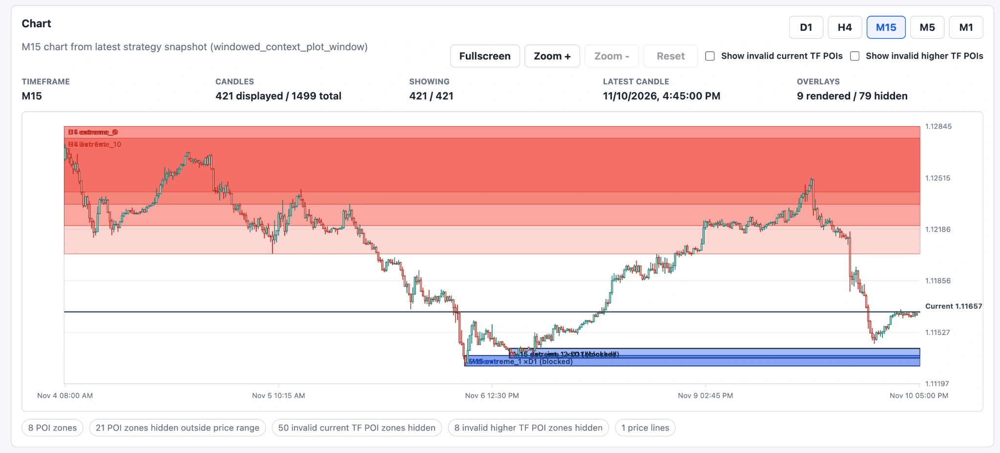
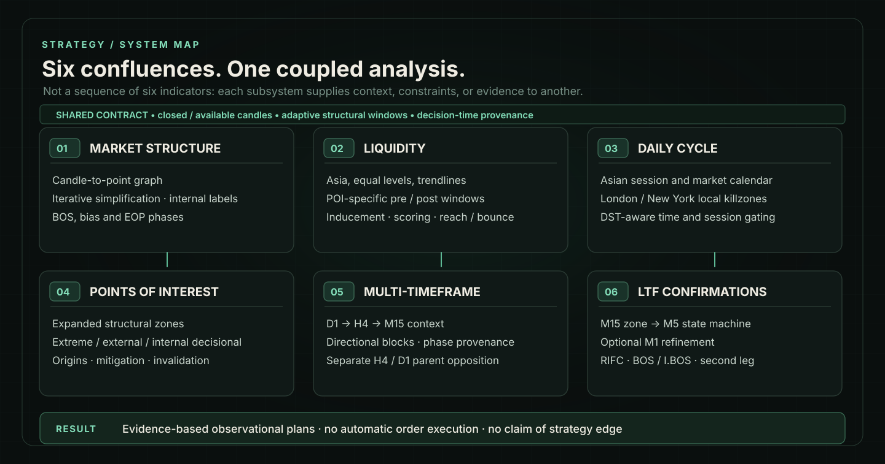
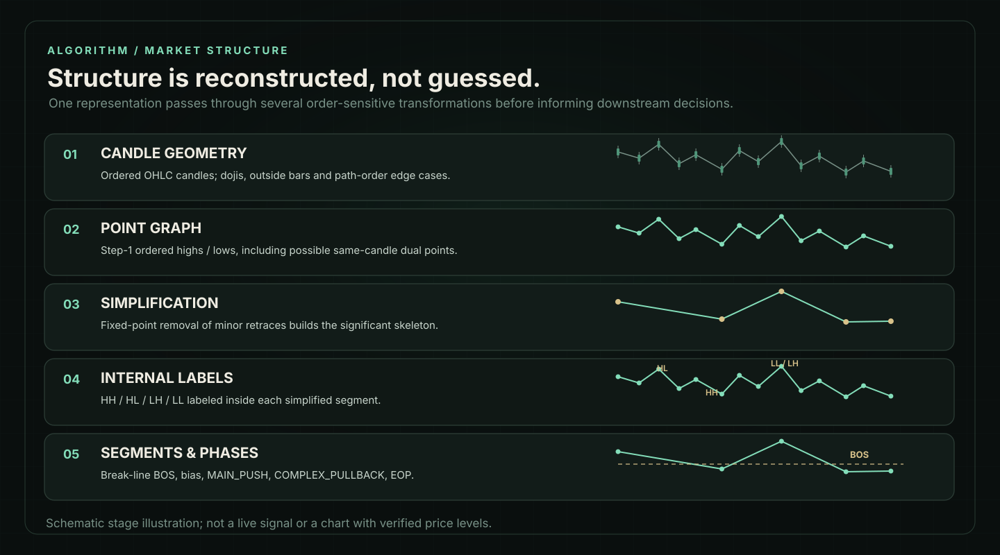
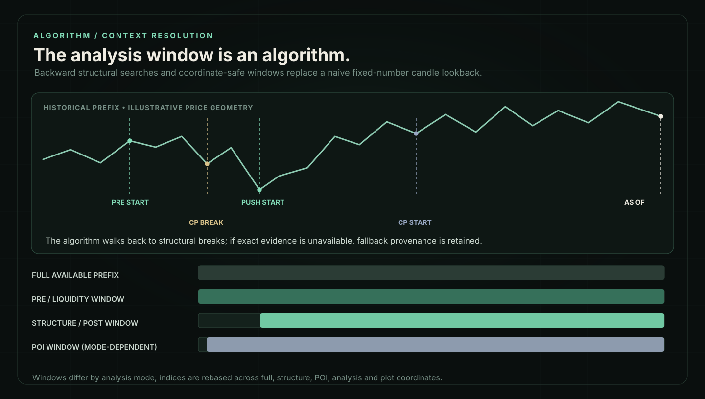
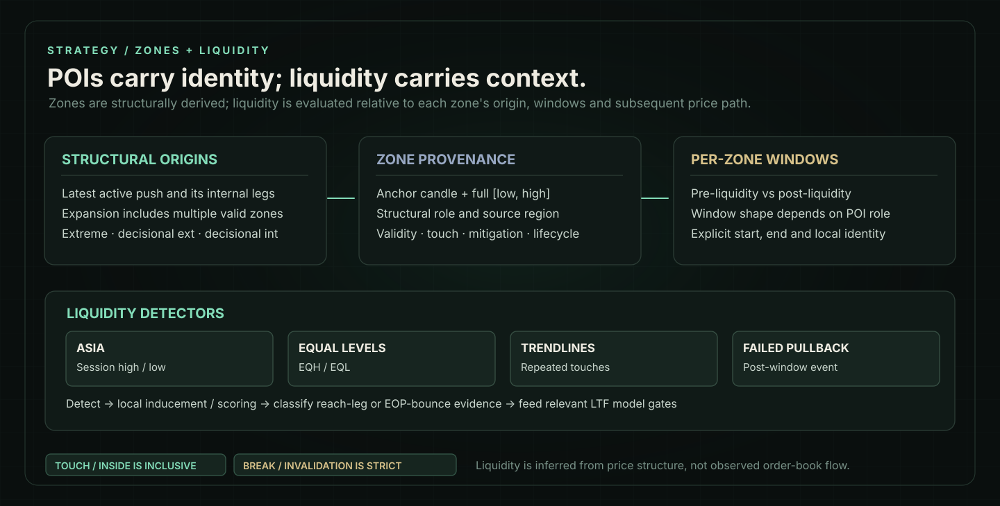
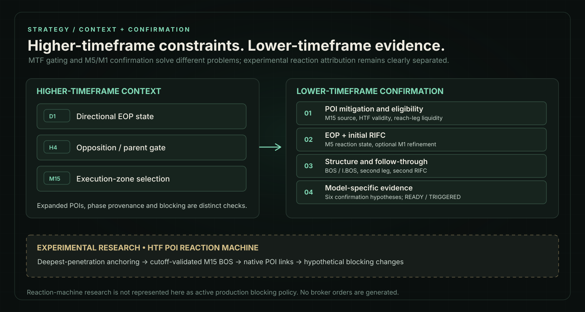
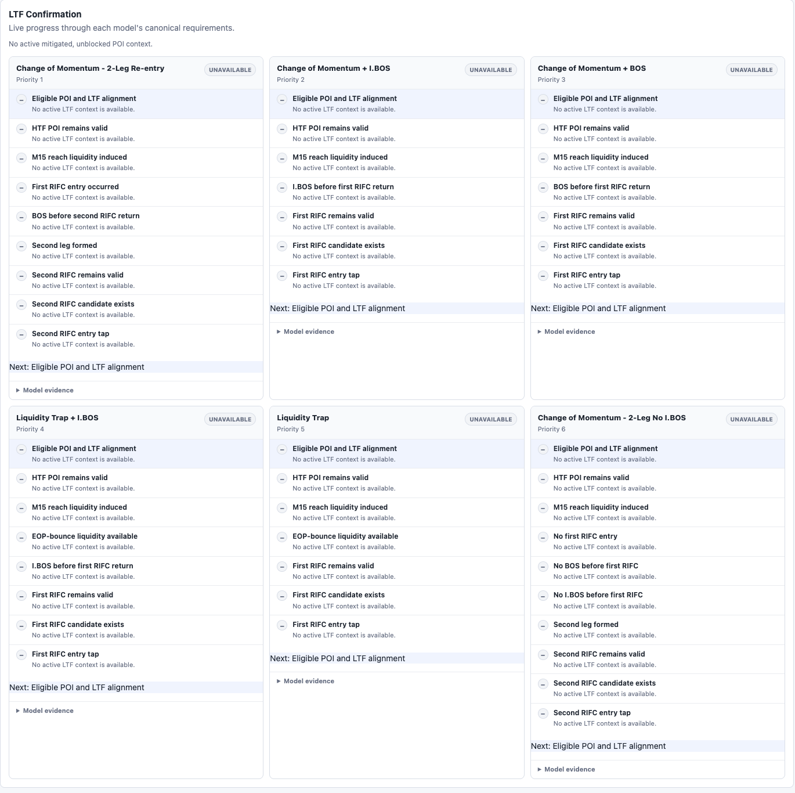
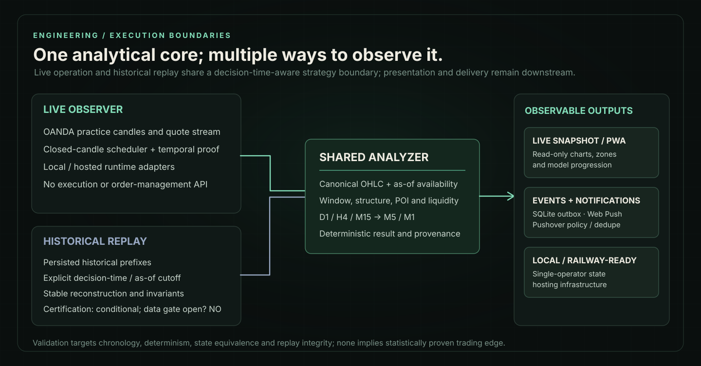

# FX Observer

**A deterministic, multi-timeframe foreign-exchange research and live-observation system.**

FX Observer is a Python research platform for a rules-based EUR/USD strategy. It converts raw price data into structured market context, evaluates **six interacting confluences**, and exposes observational trade plans through a live browser dashboard. The same core analytical boundary is available to historical replay, where chronology, reconstruction and determinism can be tested.

The implementation is private. This repository is a technical case study, not a trading service or a published strategy.

### The observer in practice

*Real M15 observer snapshot, with visible POI zones and directional blocking. The chart represents one market state, not an illustrative or completed trade.*

> **Scope:** research and observation only. No broker order submission or position management. No demonstrated profitability or validated trading edge.

## The strategy, as a system

The strategy is built around six connected analytical systems, not six independent indicators:

| Confluence | Responsibility |
| --- | --- |
| **Market structure** | Reconstructs structural points, internal and external relationships, bias, BOS, active push/pullback phases and EOP context. |
| **Liquidity** | Classifies Asia-session levels, equal highs/lows, trendline events and failed pullbacks; distinguishes pre/post inducement and reaction-side liquidity. |
| **Daily cycle** | Defines Asia context, London and New York killzones, DST-aware timing, market-week boundaries and the New York trading-day close. |
| **Points of interest** | Builds expanded, structure-derived supply/demand zones with explicit origin, priority, touch, validity and invalidation rules. |
| **Multi-timeframe analysis** | Propagates D1/H4/M15 direction and phase provenance, applies directional blocking, and enforces a separate higher-timeframe parent-opposition check. |
| **Lower-timeframe confirmation** | Uses the M15 POI as the candidate source, M5 for the reaction state machine and M1 where needed for refinement, before evaluating model-specific evidence. |

**The confluences are coupled.** Structural reconstruction helps define POIs and their phases; POI roles determine relevant liquidity windows; higher-timeframe context constrains which reactions are eligible; and the lower-timeframe engine tests specific evidence before an observational plan can be produced.

## Reconstructing market structure

Market structure is not inferred from a conventional fixed-period pivot indicator.

The engine starts with an **ordered candle-to-point graph** that handles direction changes, outside candles and same-candle dual events. It repeatedly simplifies minor retraces to obtain a significant point skeleton. Within those segments it labels internal HH/HL/LH/LL structure, calculates segment direction and **external breaks against an active break line**, then assigns structural phases: `MAIN_PUSH`, `COMPLEX_PULLBACK`, and POI-dependent **end-of-pullback (EOP)** outcomes.

These stages are order-sensitive. Internal structure and the simplified external skeleton serve different purposes; an internal BOS/I.BOS source cannot simply be replaced by raw significant points. The result includes phase and source provenance, not just a bullish/bearish label.

<strong>Engineering notes: why the structure pipeline is harder than a pivot detector</strong>

- Point-graph construction can emit two ordered points on the same candle; their emitted path order matters to later segment attribution.
- Simplification iterates until the graph stops changing rather than running one removal pass.
- Internal labels are assigned inside simplified segments, while the active external break line governs bias transitions.
- EOP selection uses a configured POI source. The expanded POI path is the default; legacy modes exist for compatibility and comparison.
- Subsequent modules must respect the timestamp at which an EOP becomes **knowable**, which may be later than its source candle.

## Adaptive windows: deciding which history matters

A fixed “last N bars” lookback is insufficient for this approach. The **window-selection algorithm is itself a substantial component**.

It first identifies a recent main-push/complex-pullback context, walks backward for a structural break of the pullback-start level, derives the actual main-push extreme, and resolves an earlier pre-liquidity anchor using another backward search. When the exact boundary is unavailable, it uses an explicitly recorded full-maximum-window estimate—not an unreported default.

Different computations operate on different historical slices: **full reference, structure, POI, analysis/liquidity, and display**. Moving a point, candle anchor or liquidity event between these slices requires explicit coordinate rebasing. Cross-timeframe M15→M5/M1 correspondence is instead mapped through time.

This creates a central replay invariant: **the window at a historical decision must be reconstructed using only information available by that decision**. Cropping today's reconstructed graph at an earlier timestamp is not equivalent.

## Expanded POIs and liquidity

The default strategy evaluates an **expanded set** of structurally derived POIs, rather than choosing only one extreme and two decisional zones. Zones are attributed to internal legs and pre-push context, and retain structural role, anchor, provenance, priority and lifecycle state.

For each valid zone, the liquidity engine builds its own pre/post context and searches for **Asia highs/lows, equal highs/lows, trendline liquidity and failed pullbacks**. It uses inducement checks and scoring to distinguish relevant events. The downstream reaction logic separates **reach-leg liquidity** from **EOP-bounce liquidity**; these are not the same signal.

Touch/inside comparisons are inclusive; breaks and invalidations are strict. “Liquidity” here means *price-geometry-based hypotheses about where orders might rest*, not direct observation of an order book.

## Multi-timeframe constraints and lower-timeframe confirmation

The default higher-timeframe analysis processes **D1 → H4 → M15**. Directional blocking uses authoritative phase provenance and preserves each POI's validity independently of whether the higher timeframe currently opposes it. The **H4/D1 parent-opposition gate** is a separate check.

On an eligible, touched M15 zone, the lower-timeframe engine evaluates an M5 reaction sequence and uses M1 where appropriate to refine internal structure. Its stages include EOP availability, reach/bounce liquidity, first and potentially second RIFC candidates, BOS, I.BOS, second-leg chronology, and model-specific confirmation requirements.

The six named **LTF models** are *not* the six strategy confluences. They are alternative confirmation hypotheses, including change-of-momentum, BOS/I.BOS, liquidity-trap and second-leg/re-entry paths. Model state is tracked as `BLOCKED`, `FORMING`, `READY`, `TRIGGERED` or `INVALID`. Read-only trade plans may describe hypothetical entry, stop, invalidation, target and risk sizing; they are never submitted to a broker.

### Actual lower-timeframe model dashboard

*The six LTF confirmation models and their per-model requirements. This particular snapshot has no eligible, mitigated POI, so the displayed model statuses are unavailable—not failed or triggered.*

### Research branch: HTF POI reaction attribution

Ongoing work explores more precise historical reactions to higher-timeframe POIs: deepest-penetration anchoring, cutoff-validated M15 BOS confirmation, re-anchoring after new extremes, links to native M15 POIs, and candidate exceptions to directional blocking.

**This is an experimental branch, not a claim that the reaction machine is active in the production analysis path.** Local experiments and diagnostic visualizations should not be confused with deployed strategy policy. Alternative extreme-anchored RIFC selection is likewise research, not the default runtime rule.

## Live observation, deterministic replay and delivery

**A shared strategy-analysis boundary** accepts canonical market frames and explicit decision-time/availability evidence. Live observation and replay supply those inputs differently, but should not maintain two subtly different definitions of the strategy.

| Layer | Engineering details |
| --- | --- |
| **Market-data boundary** | OANDA practice data, explicit candle closure/availability, synchronized decision cutoffs and a separate realtime quote/presentation lane. |
| **Replay and audit** | Deterministic historical decisions, reconstructed prefixes, future-data sentinels, chronology assertions, stable provenance and live/replay equivalence checks. |
| **Browser / iPhone PWA** | Read-only multi-timeframe charts and POI overlays, LTF model progress, hypothetical plans, live state updates and an installable browser experience. |
| **Notifications** | Stable semantic event identities, policy routing, deduplication, an atomic SQLite outbox, asynchronous delivery, Web Push and optional Pushover. |
| **Account / preferences** | Read-only TradeLocker account information for sizing, manual balance alternatives, user-set model/POI eligibility and frozen plan-sizing context. |
| **Operations** | Local macOS observer workflow, private Tailscale access, status/backup tooling, Docker packaging and Railway deployment preparation. |

The browser presents published analysis state rather than recomputing market structure, POI validity or model confirmation in JavaScript. Alerts are derived from completed strategy-state transitions, not from every price tick.

<strong>Temporal correctness and replay limitations</strong>

Replay validates much more than whether a function returns the same answer twice. It must preserve which candle data, structural boundaries, POIs, liquidity events and confirmations were available at each historical cutoff.

The recorded Replay-3C result was **`conditionally_certified`**, not fully certified. Its backtesting gate remains closed because the available market-data overlap and completeness did not satisfy all required evidence categories. Passing deterministic and lookahead-safety checks does **not** establish predictive power, expectancy or profitability.

<strong>Hosting and runtime-status distinction</strong>

The source includes an attended local observer and documented infrastructure for a single-service Railway deployment with persistent-state boundaries, owner authentication and read-only account integration. **Railway readiness does not by itself establish that a live Railway deployment is operating.** The public showcase describes hosting capabilities conservatively pending verification.

## What this project demonstrates

- **Algorithm design:** multi-pass, structural point-graph inference; dynamic historical-context discovery; zone-relative liquidity and confirmation logic.
- **Temporal data engineering:** explicit as-of semantics, window-coordinate rebasing, cutoff reconstruction and deterministic replay.
- **Stateful systems:** continuous observation, read-only dashboard state, stable alert identity, transactional delivery and persistence boundaries.
- **Verification discipline:** meaningful failure and fallback states, reproducible scenarios, chronology-sensitive regression suites and documented research limitations.

**Stack:** Python · OANDA practice REST / pricing · pandas · SQLite · pytest · browser JavaScript · Server-Sent Events · PWA · Web Push · Tailscale · Docker · Railway deployment configuration.

## Status and source availability

This is a **single-operator research/observation platform**, not automated or production trading software. The live observer does not place, modify or close orders; the strategy has not established a statistically validated edge. New HTF reaction mechanisms remain research work, and live hosting status is not asserted beyond what can be verified.

The implementation and operational configuration remain private. This repository publishes the architectural concepts and supporting visuals without source code, credentials, account identifiers, proprietary datasets or claimed trade results.

*Architecture diagrams are illustrative and describe implemented subsystem relationships unless explicitly marked experimental. They do not depict historical trades or a validated strategy outcome.*
